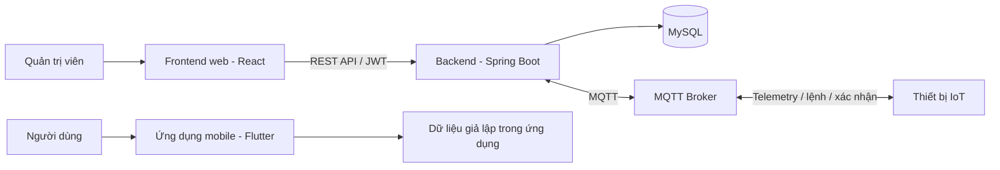

# Hệ thống tưới cây thông minh (Auto Watering System)

## Giới thiệu

Auto Watering System là hệ thống IoT hỗ trợ theo dõi môi trường trồng cây và điều khiển tưới. Dự án gồm backend cung cấp API cho tài khoản, thiết bị và dữ liệu cảm biến; frontend web quản trị; và ứng dụng mobile Flutter để người dùng quản lý thiết bị IoT.

Các chức năng chính:

- Đăng ký, đăng nhập và xác thực API bằng JWT.
- Quản lý thiết bị, cấu hình ngưỡng cảm biến, chế độ tưới và lịch tưới.
- Gửi lệnh bật/tắt máy bơm và nhận xác nhận từ thiết bị.
- Nhận dữ liệu cảm biến qua MQTT và lưu vào MySQL.
- Xem thống kê môi trường và mực nước trên dashboard quản trị.
- Ứng dụng mobile có màn hình tổng quan, tự động hóa, quản lý thành viên, cài đặt và danh sách thiết bị.

## Kiến trúc



- **Backend (`backend/`)**: Java 21 và Spring Boot 3, tổ chức theo controller, service, repository và model. Spring Security/JWT xác thực người dùng; Spring Data JPA truy cập MySQL; Spring Integration MQTT nhận telemetry/trạng thái/xác nhận và gửi lệnh/cấu hình. Backend cũng cung cấp API thống kê và cấu hình WebSocket.
- **Frontend (`frontend/`)**: React, ứng dụng dashboard quản trị Gardenia. Dashboard gọi API đăng nhập và thống kê của backend.
- **Mobile (`mobile/`)**: Ứng dụng Flutter sử dụng BLoC để quản lý trạng thái, GoRouter để điều hướng và GetIt để đăng ký phụ thuộc. Mã nguồn tổ chức theo tính năng (`auth`, `dashboard`, `automation`, `sensor_monitor`, `device_management`, `user_management`, `profile`) với các lớp domain, data và presentation. Các repository hiện được đăng ký chủ yếu là mock để chạy thử giao diện; mobile chưa kết nối API/MQTT thực tế.
- **Thiết bị IoT**: Gửi dữ liệu cảm biến lên MQTT, nhận lệnh điều khiển/cấu hình và phản hồi trên topic xác nhận.

### Luồng MQTT

| Mục đích | Topic | QoS |
| --- | --- | --- |
| Dữ liệu cảm biến | `iot/garden/{device_id}/telemetry` | 0 |
| Lệnh máy bơm | `iot/garden/{device_id}/cmd` | 1 |
| Cấu hình thiết bị | `iot/garden/{device_id}/config` | 1 |
| Trạng thái / LWT | `iot/garden/{device_id}/status` | 1 |
| Xác nhận lệnh/cấu hình | `iot/garden/{device_id}/ack` | 1 |

Thiết bị gửi xác nhận sau khi xử lý lệnh hoặc cấu hình. Backend chờ xác nhận; trạng thái lệnh được giữ trong bộ nhớ tối đa 24 giờ và bị xóa khi backend khởi động lại. Thiết bị nên gửi telemetry mỗi 10–30 giây.

### Quản lý MQTT users trên EMQX Cloud

`MQTT_USERNAME`/`MQTT_PASSWORD` trong cấu hình backend là tài khoản kết nối của backend tới broker, khác với tài khoản riêng của ESP32. Khi admin tạo thiết bị, backend sinh `mqtt_username`/`mqtt_password`, lưu chúng vào MySQL và tạo cùng user đó trong built-in authentication database của EMQX qua Management API. Khi admin decommission thiết bị, backend xóa user khỏi EMQX trước khi xóa credential và liên kết trong MySQL. Nếu EMQX API lỗi, thao tác thiết bị thất bại thay vì trả về thành công giả.

Cấu hình backend bằng các biến môi trường (không commit API secret):

| Biến | Ý nghĩa |
| --- | --- |
| `EMQX_MANAGEMENT_BASE_URL` | API Endpoint đầy đủ trong Deployment Overview, gồm hậu tố `/api/v5` (không lặp thêm `/api/v5`) |
| `EMQX_API_KEY`, `EMQX_API_SECRET` | API key/secret có quyền quản lý authentication users |
| `EMQX_AUTHENTICATOR_ID` | ID của built-in password authenticator; mặc định `password_based:built_in_database` |

Trong EMQX Cloud Console, vào **Deployment Overview** và kéo xuống phần **Deployment API Key** (ảnh minh họa trong console). Dùng **New API Key** để tạo App ID/App Secret cho deployment; lưu App Secret ngay lúc tạo và đặt App ID vào `EMQX_API_KEY`, App Secret vào `EMQX_API_SECRET`. Sao chép nguyên **API Endpoint** trong cùng phần vào `EMQX_MANAGEMENT_BASE_URL`; endpoint này đã kết thúc bằng `/api/v5`, không tự thêm hậu tố lần nữa. Xác định authenticator ID của **Default Authentication / Built-in Database**, sau đó đặt các giá trị trong secret manager/environment backend. API key/secret được gửi dưới HTTP Basic Authentication qua HTTPS; backend không log credential MQTT thiết bị hoặc API secret. Không gửi secrets trong chat hoặc commit vào repository. Backend gọi `POST /authentication/{authenticatorId}/users` tương đối với API Endpoint, body gồm `user_id`, `password`, `is_superuser=false`, và `DELETE` trên cùng endpoint theo `user_id`.

Sau khi cập nhật cấu hình và triển khai backend, tạo thiết bị thử nghiệm và xác nhận username xuất hiện trong danh sách built-in users của EMQX; thử kết nối thiết bị bằng username/password trả về một lần trong API tạo thiết bị. Khi admin decommission, backend trước hết tra cứu các phiên theo username, ngắt từng phiên đang kết nối, rồi xóa user khỏi EMQX; chỉ sau khi broker xác nhận mới xóa credential và liên kết trong MySQL. Nếu tra cứu/ngắt phiên/xóa user thất bại, API trả lỗi và không chuyển trạng thái DB sang `decommissioned`; thao tác có thể thử lại an toàn. Authentication cũng không tự giới hạn topic: cấu hình authorization/ACL trong EMQX để mỗi device chỉ được truy cập topic theo MAC của chính nó.

## Yêu cầu

- Java Development Kit (JDK) 21.
- MySQL và một database đã được tạo, có schema phù hợp với ứng dụng. Hibernate hiện đặt `ddl-auto=none`, repository không cung cấp tập tin SQL khởi tạo schema.
- Một MQTT broker có thể truy cập được từ backend.
- Node.js và npm để chạy frontend.
- Flutter SDK (Dart SDK tương thích với ràng buộc `sdk: ^3.5.0` trong `mobile/pubspec.yaml`) và Android emulator hoặc thiết bị Android để chạy mobile.
- Git nếu cần lấy mã nguồn.

## Cài đặt và chạy

### 1. Chuẩn bị cấu hình backend

Từ thư mục gốc repository, sao chép cấu hình mẫu:

```powershell
Copy-Item .env.example .env
```

Backend tự đọc `.env` ở thư mục gốc hoặc `backend\.env` (nếu có cả hai, file `backend\.env` được ưu tiên). Không commit `.env`.

Chỉnh `backend\.env` và điền thông tin thực tế, không commit thông tin bí mật:

| Biến | Ý nghĩa |
| --- | --- |
| `DB_URL` | JDBC URL của database, ví dụ `jdbc:mysql://localhost:3306/auto_watering` |
| `DB_USERNAME`, `DB_PASSWORD` | Tài khoản MySQL |
| `JWT_SECRET_KEY` | Khóa bí mật để ký JWT |
| `JWT_ACCESS_TOKEN_EXPIRATION` | Thời hạn access token theo định dạng backend yêu cầu |
| `CORS_ALLOWED_ORIGIN_PATTERNS` | Các origin được phép gọi API, ví dụ `http://localhost:3000` |
| `REFRESH_TOKEN_EXPIRATION_DAYS` | Thời hạn refresh token tính theo ngày |
| `MQTT_BROKER_URL` | Địa chỉ broker, ví dụ `tcp://localhost:1883` hoặc `ssl://<MQTT_HOST>:8883` |
| `MQTT_USERNAME`, `MQTT_PASSWORD` | Thông tin xác thực broker nếu broker yêu cầu |
| `MQTT_CLIENT_ID` | Client ID của backend trên broker |

Các biến CORS và refresh token không có trong `.env.example`; hãy bổ sung chúng vào `backend\.env`. MQTT được bật trong cấu hình backend, vì vậy cần cung cấp broker có thể kết nối.

Đảm bảo MySQL đang chạy, database đã có schema cần thiết và broker MQTT sẵn sàng trước khi khởi động backend.

### 2. Chạy backend

Mở terminal tại thư mục `backend`:

```powershell
.\mvnw.cmd spring-boot:run
```

Backend mặc định chạy tại `http://localhost:8080`. Để chạy kiểm thử:

```powershell
.\mvnw.cmd test
```

### 3. Cài đặt và chạy frontend

Mở terminal thứ hai tại thư mục `frontend`, cài dependencies và chạy ứng dụng:

```powershell
npm install
npm start
```

Frontend mặc định mở tại `http://localhost:3000` và đã cấu hình gọi backend local tại
`http://localhost:8080` trong `frontend\.env.development`. Nếu backend chạy ở
máy hoặc địa chỉ khác, cập nhật biến `REACT_APP_API_BASE_URL` trong tệp này rồi
khởi động lại frontend. Với bản production, đặt biến này thành URL backend
production trước khi chạy `npm run build`; React đọc biến môi trường tại thời
điểm build.

Origin của frontend cũng cần được cho phép trong `CORS_ALLOWED_ORIGIN_PATTERNS` của backend. Đăng nhập bằng tài khoản có role `ADMIN`; tài khoản khác không được truy cập dashboard quản trị.

Tạo bản build production bằng:

```powershell
npm run build
```

### 4. Cài đặt và chạy ứng dụng mobile

Mở terminal tại thư mục `mobile`, tải dependencies và khởi chạy ứng dụng trên emulator/thiết bị đang kết nối:

```powershell
flutter pub get
flutter run
```

Có thể xem các thiết bị Flutter nhận diện bằng `flutter devices`, sau đó chọn thiết bị cụ thể với `flutter run -d <device_id>`. Mobile hiện hoạt động ở chế độ UI với repository mock; đăng nhập, số liệu cảm biến và thao tác thiết bị là dữ liệu thử nghiệm, chưa được gửi đến backend. Vì vậy có thể chạy mobile độc lập, không cần cấu hình MySQL hoặc MQTT.

## API thiết bị và xác nhận lệnh

Các API thiết bị yêu cầu bearer token. Thiết bị phải thuộc người dùng đã xác thực.

| Phương thức | Endpoint | Chức năng |
| --- | --- | --- |
| `GET` | `/api/devices/{id}/config` | Đọc cấu hình và ngưỡng thiết bị |
| `PUT` | `/api/devices/{id}/config` | Lưu cấu hình và gửi cấu hình đến thiết bị |
| `POST` | `/api/devices/{id}/control` | Gửi lệnh điều khiển máy bơm |
| `POST` | `/api/devices/{id}/mode` | Cập nhật chế độ `auto` hoặc `manual` |
| `GET` | `/api/devices/{id}/schedules` | Liệt kê lịch tưới |
| `POST` | `/api/devices/{id}/schedules` | Tạo lịch tưới |
| `PUT` | `/api/devices/{id}/schedules/{scheduleId}` | Cập nhật lịch tưới |
| `DELETE` | `/api/devices/{id}/schedules/{scheduleId}` | Xóa lịch tưới |
| `POST` | `/api/devices/{id}/register` | Gán thiết bị cho người dùng (quyền admin) |
| `GET` | `/api/devices/{id}/commands/{commandId}/ack` | Kiểm tra trạng thái xác nhận lệnh |
| `POST` | `/api/devices/{id}/ble-status` | Chủ sở hữu báo kết quả kiểm tra BLE bằng `{"reachable":true\|false}` |
| `POST` | `/api/devices/{id}/viewers/{viewerId}` | Chủ sở hữu chia sẻ thiết bị với tài khoản người dùng |
| `DELETE` | `/api/devices/{id}/viewers/{viewerId}` | Chủ sở hữu xóa quyền truy cập của viewer |
| `POST` | `/api/devices/{id}/viewers/{viewerId}/lock` | Chủ sở hữu tạm khóa quyền xem |
| `DELETE` | `/api/devices/{id}/viewers/{viewerId}/lock` | Chủ sở hữu mở khóa quyền xem |
| `POST` | `/api/devices/{id}/maintenance` | Chủ sở hữu tạm ngưng điều khiển để bảo trì |
| `POST` | `/api/devices/{id}/maintenance/complete` | Chủ sở hữu kết thúc bảo trì |

API quản trị thiết bị (yêu cầu bearer token ADMIN):

| Phương thức | Endpoint | Chức năng |
| --- | --- | --- |
| `GET` | `/api/admin/devices` | Liệt kê thiết bị, trạng thái, phiên bản phần cứng/phần mềm và lần hoạt động gần nhất |
| `POST` | `/api/admin/devices` | Thêm thiết bị mới bằng địa chỉ MAC |
| `POST` | `/api/admin/devices/{id}/maintenance` | Chuyển thiết bị sang bảo trì |
| `POST` | `/api/admin/devices/{id}/maintenance/complete` | Kết thúc bảo trì |
| `POST` | `/api/admin/devices/{id}/decommission` | Admin quyết định thu hồi quyền sử dụng, ngừng thiết bị, xóa credential backend và gỡ liên kết người dùng |

Yêu cầu thêm thiết bị nhận `id` (MAC theo dạng `AA:BB:CC:DD:EE:FF`, bắt buộc), cùng các trường tùy chọn `deviceName`, `hardwareVersion`, `firmwareVersion`. Thiết bị mới có trạng thái `registered`; backend tạo khóa BLE và MQTT ngẫu nhiên, lưu lại và trả `ble_secret_key`, `mqtt_username`, `mqtt_password` một lần trong response `201 Created` để phục vụ provisioning. MQTT username có dạng `dev_AABBCCDDEEFF`; username/password không vượt quá 55 ký tự. API liệt kê thiết bị không trả các thông tin xác thực này. Gán chủ sở hữu bằng `POST /api/devices/{id}/register` chuyển thiết bị sang `provisioned`, không tự đánh dấu đã kết nối.

Role tài khoản chỉ gồm `user` và `admin`; owner/viewer là quyền theo từng thiết bị trong `user_device.permission`. Đăng ký mới và được admin gán thiết bị không đổi role tài khoản; người được gán nhận permission `owner`. Owner có thể cấp hoặc xóa liên kết `viewer`; viewer dùng được các API đọc, cấu hình, điều khiển và lịch tưới như owner, nhưng không thể xóa lịch hoặc quản lý/chia sẻ quyền người dùng khác. Tài khoản bị khóa (`viewer_locked`) không truy cập thiết bị.

Vòng đời lưu trong cột `device.status`: `registered` → `provisioned` → `active` ↔ `offline`; các trạng thái ngoại lệ gồm `fault`, `maintenance`, `decommissioned`. Thiết bị chỉ được điều khiển/cập nhật cấu hình từ xa khi `active`; người dùng được chia sẻ có thể đọc trạng thái khi offline và điều khiển BLE tại chỗ. Sau đăng ký, thiết bị cần publish JSON `{"status":"ACTIVE","firmware_version":"1.0.0"}` lên `iot/garden/{MAC}/status` khi kết nối MQTT và publish `{"status":"OFFLINE"}` trong Last Will. Heartbeat được tính từ bản tin ACTIVE hoặc telemetry; sau 30 giây không có heartbeat, backend tự chuyển `active` thành `offline` (scheduler kiểm tra mỗi 10 giây). Bản tin `{"status":"MAINTENANCE"}` hoặc API bảo trì chuyển trạng thái sang `maintenance`. Khi kết thúc bảo trì, backend khôi phục `active` nếu heartbeat còn mới, `provisioned` nếu đã gán chủ sở hữu nhưng chưa hoạt động, hoặc `registered` nếu chưa gán.

Mobile gửi kết quả BLE qua `POST /api/devices/{id}/ble-status` với `{"reachable":false}` để đánh dấu `fault`; gửi `{"reachable":true}` sau đó sẽ phục hồi về `active`, `offline` hoặc `provisioned` dựa trên heartbeat. Chủ sở hữu có thể khóa/mở quyền `viewer` riêng; tài khoản bị khóa không thấy thiết bị. Chỉ owner được thêm/xóa/khóa/mở viewer; viewer được phép thao tác trên thiết bị như owner, ngoại trừ xóa lịch và quản lý quyền chia sẻ.

Nếu database đang có role tài khoản `owner` hoặc `viewer`, cập nhật dữ liệu trước khi triển khai phiên bản mới:

```sql
UPDATE `user`
SET role = 'user'
WHERE LOWER(role) IN ('owner', 'viewer');
```

Role converter có ánh xạ tương thích các giá trị cũ sang `USER` khi đọc, nhưng câu lệnh trên đảm bảo dữ liệu MySQL chỉ còn `user`/`admin`. Người dùng cần đăng nhập lại để nhận JWT mới với role `USER`.

Chỉ quản trị viên mới được quyết định ngừng sử dụng thiết bị thông qua `POST /api/admin/devices/{id}/decommission`; chủ sở hữu không có API tự chuyển trạng thái này. Khi admin thu hồi quyền sử dụng, backend xóa MQTT user khỏi EMQX trước, sau đó đặt trạng thái `decommissioned`, xóa khóa BLE/MQTT trong database và gỡ tất cả liên kết người dùng. Nếu không xóa được broker user, thao tác thất bại để admin có thể xử lý và thử lại. Xóa user chặn các kết nối MQTT mới sau khi EMQX áp dụng thay đổi, nhưng có thể không ngắt ngay phiên đang kết nối. MQTT topic status vẫn cần ACL/authorization riêng theo từng thiết bị; Authentication không tự ngăn client hợp lệ giả mạo status trên topic thiết bị khác.

Yêu cầu cấu hình dùng các trường `auto_mode`, `soil_moisture_min`, `soil_moisture_max`, `max_watering_duration`, `air_humidity_min`, `air_humidity_max`, `air_temperature_min`, `air_temperature_max` và `water_level_min`. Yêu cầu chế độ tưới có dạng `{"mode":"auto"}` hoặc `{"mode":"manual"}`. Lịch tưới dùng `start_time`, `end_time`, `duration_minutes`, `days_of_week` và tùy chọn `is_enabled`.

Lệnh điều khiển có thể dùng `{"action":"ON","duration_seconds":300}` hoặc `{"action":"OFF"}`. `duration_seconds` không bắt buộc, mặc định là 300 giây hoặc giới hạn tối đa được cấu hình nếu nhỏ hơn. Thời lượng bật bơm vượt giới hạn cấu hình sẽ bị từ chối; lệnh tắt bơm gửi thời lượng bằng 0.

Phản hồi gửi lệnh/cấu hình có `command_id` và `command_status: "PENDING"`. Dùng endpoint xác nhận ở bảng trên để kiểm tra trạng thái `PENDING`, `SUCCEEDED`, `FAILED` hoặc `PUBLISH_FAILED`. Thiết bị cần phản hồi trên topic `/ack` với cùng `command_id`; khi xử lý thất bại, gửi `status: "FAILED"` cùng thông điệp chẩn đoán. Backend chờ gửi MQTT tối đa 5 giây mỗi lần và thử lại tối đa 3 lần; nếu không gửi được, API trả `503 Service Unavailable`.

API dashboard thống kê:

- `GET /api/admin/statistics/environmental?deviceId={id}&range={24h|7d|30d}`
- `GET /api/admin/statistics/water-level?deviceId={id}&range={24h|7d|30d}`

## Tài liệu mobile

Tài liệu kiến trúc và thiết kế mobile nằm trong [`mobile/docs/`](mobile/docs/), bao gồm [architecture.md](mobile/docs/architecture.md).
