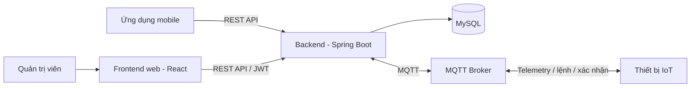

# Hệ thống tưới cây thông minh (Auto Watering System)

## Giới thiệu

Auto Watering System là hệ thống IoT hỗ trợ theo dõi môi trường trồng cây và điều khiển tưới. Backend cung cấp API cho tài khoản, thiết bị và dữ liệu cảm biến; giao tiếp với thiết bị qua MQTT. Frontend web hiện là trang quản trị, cho phép đăng nhập bằng tài khoản `ADMIN` và xem thống kê cảm biến theo thiết bị.

Các khả năng chính:

- Đăng ký, đăng nhập và xác thực API bằng JWT.
- Quản lý thiết bị, cấu hình ngưỡng cảm biến, chế độ tưới và lịch tưới.
- Gửi lệnh bật/tắt máy bơm và nhận xác nhận từ thiết bị.
- Nhận dữ liệu cảm biến qua MQTT và lưu vào MySQL.
- Xem thống kê môi trường và mực nước trên dashboard quản trị.

## Kiến trúc



- **Backend (`backend/`)**: Java 21 và Spring Boot 3, tổ chức theo controller, service, repository và model. Spring Security/JWT xác thực người dùng; Spring Data JPA truy cập MySQL; Spring Integration MQTT nhận telemetry/trạng thái/xác nhận và gửi lệnh/cấu hình. Backend cũng cung cấp API thống kê và cấu hình WebSocket.
- **Frontend (`frontend/`)**: React, ứng dụng dashboard quản trị Gardenia. Dashboard gọi API đăng nhập và thống kê của backend.
- **Thiết bị IoT**: Gửi dữ liệu cảm biến lên MQTT, nhận lệnh điều khiển/cấu hình và phản hồi trên topic xác nhận.
- **Mobile (`mobile/`)**: Thư mục hiện có tài liệu thiết kế/kiến trúc Flutter, chưa có mã nguồn Dart hoặc `pubspec.yaml` trong repository; do đó chưa thể cài đặt và chạy ứng dụng mobile từ checkout này.

### Luồng MQTT

| Mục đích | Topic | QoS |
| --- | --- | --- |
| Dữ liệu cảm biến | `iot/garden/{device_id}/telemetry` | 0 |
| Lệnh máy bơm | `iot/garden/{device_id}/cmd` | 1 |
| Cấu hình thiết bị | `iot/garden/{device_id}/config` | 1 |
| Trạng thái / LWT | `iot/garden/{device_id}/status` | 1 |
| Xác nhận lệnh/cấu hình | `iot/garden/{device_id}/ack` | 1 |

Thiết bị gửi xác nhận sau khi xử lý lệnh hoặc cấu hình. Backend chờ xác nhận; trạng thái lệnh được giữ trong bộ nhớ tối đa 24 giờ và bị xóa khi backend khởi động lại. Thiết bị nên gửi telemetry mỗi 10–30 giây.

## Yêu cầu

- Java Development Kit (JDK) 21.
- MySQL và một database đã được tạo, có schema phù hợp với ứng dụng. Hibernate hiện đặt `ddl-auto=none`, repository không cung cấp tập tin SQL khởi tạo schema.
- Một MQTT broker có thể truy cập được từ backend.
- Node.js và npm để chạy frontend.
- Git nếu cần lấy mã nguồn.

## Cài đặt và chạy

### 1. Chuẩn bị cấu hình backend

Từ thư mục gốc repository, sao chép cấu hình mẫu vào thư mục backend:

```powershell
Copy-Item .env.example backend\.env
```

Chỉnh `backend\.env` và điền thông tin thực tế, không commit thông tin bí mật:

| Biến | Ý nghĩa |
| --- | --- |
| `DB_URL` | JDBC URL của database, ví dụ `jdbc:mysql://localhost:3306/auto_watering` |
| `DB_USERNAME`, `DB_PASSWORD` | Tài khoản MySQL |
| `JWT_SECRET_KEY` | Khóa bí mật để ký JWT |
| `JWT_ACCESS_TOKEN_EXPIRATION` | Thời hạn access token theo định dạng backend yêu cầu |
| `CORS_ALLOWED_ORIGIN_PATTERNS` | Các origin được phép gọi API, ví dụ `http://localhost:3000` |
| `REFRESH_TOKEN_EXPIRATION_DAYS` | Thời hạn refresh token tính theo ngày |
| `MQTT_BROKER_URL` | Địa chỉ broker, ví dụ `tcp://localhost:1883` hoặc `ssl://<MQTT_HOST>:8883` |
| `MQTT_USERNAME`, `MQTT_PASSWORD` | Thông tin xác thực broker nếu broker yêu cầu |
| `MQTT_CLIENT_ID` | Client ID của backend trên broker |

Các biến CORS và refresh token không có trong `.env.example`; hãy bổ sung chúng vào `backend\.env`. MQTT được bật trong cấu hình backend, vì vậy cần cung cấp broker có thể kết nối.

Đảm bảo MySQL đang chạy, database đã có schema cần thiết và broker MQTT sẵn sàng trước khi khởi động backend.

### 2. Chạy backend

Mở terminal tại thư mục `backend`:

```powershell
.\mvnw.cmd spring-boot:run
```

Backend mặc định chạy tại `http://localhost:8080`. Để chạy kiểm thử:

```powershell
.\mvnw.cmd test
```

### 3. Cài đặt và chạy frontend

Mở terminal thứ hai tại thư mục `frontend`, cài dependencies và chạy ứng dụng:

```powershell
npm install
npm start
```

Frontend mặc định mở tại `http://localhost:3000`. Nếu backend không chạy cùng origin, tạo `frontend\.env` với địa chỉ API:

```dotenv
REACT_APP_API_BASE_URL=http://localhost:8080
```

Origin của frontend cũng cần được cho phép trong `CORS_ALLOWED_ORIGIN_PATTERNS` của backend. Đăng nhập bằng tài khoản có role `ADMIN`; tài khoản khác không được truy cập dashboard quản trị.

Tạo bản build production bằng:

```powershell
npm run build
```

## API thiết bị và xác nhận lệnh

Các API thiết bị yêu cầu bearer token. Thiết bị phải thuộc người dùng đã xác thực.

| Phương thức | Endpoint | Chức năng |
| --- | --- | --- |
| `GET` | `/api/devices/{id}/config` | Đọc cấu hình và ngưỡng thiết bị |
| `PUT` | `/api/devices/{id}/config` | Lưu cấu hình và gửi cấu hình đến thiết bị |
| `POST` | `/api/devices/{id}/control` | Gửi lệnh điều khiển máy bơm |
| `POST` | `/api/devices/{id}/mode` | Cập nhật chế độ `auto` hoặc `manual` |
| `GET` | `/api/devices/{id}/schedules` | Liệt kê lịch tưới |
| `POST` | `/api/devices/{id}/schedules` | Tạo lịch tưới |
| `PUT` | `/api/devices/{id}/schedules/{scheduleId}` | Cập nhật lịch tưới |
| `DELETE` | `/api/devices/{id}/schedules/{scheduleId}` | Xóa lịch tưới |
| `POST` | `/api/devices/{id}/register` | Gán thiết bị cho người dùng (quyền admin) |
| `GET` | `/api/devices/{id}/commands/{commandId}/ack` | Kiểm tra trạng thái xác nhận lệnh |

Yêu cầu cấu hình dùng các trường `auto_mode`, `soil_moisture_min`, `soil_moisture_max`, `max_watering_duration`, `air_humidity_min`, `air_humidity_max`, `air_temperature_min`, `air_temperature_max` và `water_level_min`. Yêu cầu chế độ tưới có dạng `{"mode":"auto"}` hoặc `{"mode":"manual"}`. Lịch tưới dùng `start_time`, `end_time`, `duration_minutes`, `days_of_week` và tùy chọn `is_enabled`.

Lệnh điều khiển có thể dùng `{"action":"ON","duration_seconds":300}` hoặc `{"action":"OFF"}`. `duration_seconds` không bắt buộc, mặc định là 300 giây hoặc giới hạn tối đa được cấu hình nếu nhỏ hơn. Thời lượng bật bơm vượt giới hạn cấu hình sẽ bị từ chối; lệnh tắt bơm gửi thời lượng bằng 0.

Phản hồi gửi lệnh/cấu hình có `command_id` và `command_status: "PENDING"`. Dùng endpoint xác nhận ở bảng trên để kiểm tra trạng thái `PENDING`, `SUCCEEDED`, `FAILED` hoặc `PUBLISH_FAILED`. Thiết bị cần phản hồi trên topic `/ack` với cùng `command_id`; khi xử lý thất bại, gửi `status: "FAILED"` cùng thông điệp chẩn đoán. Backend chờ gửi MQTT tối đa 5 giây mỗi lần và thử lại tối đa 3 lần; nếu không gửi được, API trả `503 Service Unavailable`.

API dashboard thống kê:

- `GET /api/admin/statistics/environmental?deviceId={id}&range={24h|7d|30d}`
- `GET /api/admin/statistics/water-level?deviceId={id}&range={24h|7d|30d}`

## Tài liệu mobile

Tài liệu kiến trúc và thiết kế mobile nằm trong [`mobile/docs/`](mobile/docs/), bao gồm [architecture.md](mobile/docs/architecture.md). Hiện repository chưa có mã nguồn Flutter để chạy ứng dụng.
