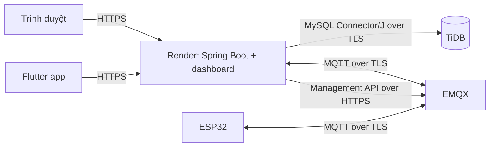

# Triển khai production

Hướng dẫn này triển khai backend Spring Boot và dashboard React lên Render, dùng
TiDB (tương thích giao thức MySQL) cùng một MQTT broker công khai có TLS (ví dụ
EMQX Cloud). Mobile và ESP32 kết nối tới backend/broker qua Internet; chúng
không cần chạy cùng mạng LAN.

## Kiến trúc triển khai



Dockerfile tại `backend/Dockerfile` build frontend và đóng gói các file tĩnh
chung với backend. Vì vậy dashboard và API dùng cùng một origin; không cần
Render Static Site riêng.

## 1. Chuẩn bị dịch vụ phụ trợ

### TiDB

Backend hiện dùng MySQL Connector/J và Hibernate MySQL dialect; TiDB hỗ trợ giao
thức MySQL nên có thể dùng làm database. Tạo database trên TiDB và chuẩn bị
schema tương thích với các entity backend. Ứng dụng đặt
`spring.jpa.hibernate.ddl-auto=none` và repository hiện không chứa schema
migration/SQL để khởi tạo database, nên cần hoàn tất bước này trước khi deploy.

Trong TiDB Cloud, lấy connection string tại **Connect** của cluster, chọn kiểu
kết nối Java/JDBC nếu có. Dùng JDBC scheme `jdbc:mysql://`; giữ nguyên host,
port, database, username (bao gồm prefix cluster nếu TiDB hiển thị) và TLS
options do TiDB cung cấp. Ví dụ minh họa, không dùng thay cho connection string
thật:

```text
jdbc:mysql://<HOST>:4000/<DATABASE>?sslMode=VERIFY_IDENTITY
```

Port `4000` và `sslMode` trong ví dụ cần được xác nhận theo cấu hình/connection
string hiển thị trong TiDB Cloud. TiDB Cloud Starter/Essential yêu cầu TLS và
public endpoint có IP access list; thêm các địa chỉ outbound Render yêu cầu
được phép kết nối. Với Dedicated cluster, bật/configure public endpoint hoặc
private connection theo network setup của bạn. Không mở truy cập rộng hơn mức
cần thiết. Đặt URL, username và password trong environment variables của Render,
không đưa credentials vào Git.

### MQTT broker (EMQX)

1. Tạo EMQX deployment có địa chỉ MQTT công khai, bật TLS listener (thường là
   cổng `8883`) và xác thực password.
2. Tạo tài khoản dịch vụ riêng cho backend. Tài khoản này được dùng trong
   `MQTT_USERNAME` / `MQTT_PASSWORD`; không dùng tài khoản này trực tiếp trên
   ESP32.
3. Nếu muốn backend tự cấp phát credentials khi tạo thiết bị, bật built-in
   password database và tạo Management API key/secret có quyền quản lý
   authentication users. Lưu authenticator ID và API Endpoint đầy đủ kết thúc
   bằng `/api/v5`.
4. Cấu hình authorization/ACL riêng: thiết bị chỉ được publish/subscribe các
   topic của chính device ID; tài khoản dịch vụ backend cần quyền phù hợp để
   nhận telemetry và gửi lệnh/cấu hình.

Backend dùng `MQTT_BROKER_URL=ssl://<MQTT_HOST>:8883` và mặc định xác minh
chứng chỉ TLS. Không đặt `MQTT_TLS_TRUST_ALL=true` trong production.

Các tài khoản EMQX do backend tạo cho từng thiết bị là riêng biệt với tài khoản
dịch vụ backend. Khi tạo thiết bị, lưu credentials trả về để provision cho
ESP32; API danh sách thiết bị không trả lại mật khẩu.

## 2. Deploy backend và dashboard lên Render

Tạo một **Web Service** từ Git repository và đặt:

| Render setting | Giá trị |
| --- | --- |
| Root Directory | Để trống (repository root) |
| Runtime | Docker |
| Dockerfile Path | `backend/Dockerfile` |
| Docker Build Context Directory | `.` |

Build context phải là repository root vì Dockerfile copy cả `backend/` và
`frontend/`. Không đổi Root Directory thành `backend`.

### Environment variables

Thêm các biến dưới đây trong **Environment** của Render. Lấy thông tin TiDB và
MQTT từ nhà cung cấp dịch vụ tương ứng; không commit giá trị thật vào `.env` hay
repository.

| Biến | Giá trị |
| --- | --- |
| `DB_URL` | JDBC URL TiDB theo giao thức MySQL; giữ các tham số TLS do TiDB yêu cầu |
| `DB_USERNAME`, `DB_PASSWORD` | Credentials do TiDB cấp |
| `JWT_SECRET_KEY` | Khóa ký JWT dạng Base64, tối thiểu 256 bit |
| `JWT_ACCESS_TOKEN_EXPIRATION` | Thời hạn access token tính bằng mili giây, ví dụ `900000` |
| `REFRESH_TOKEN_EXPIRATION_DAYS` | Thời hạn refresh token tính theo ngày, ví dụ `30` |
| `CORS_ALLOWED_ORIGIN_PATTERNS` | Origin được phép gọi API; thường là URL HTTPS của Web Service |
| `MQTT_BROKER_URL` | `ssl://<MQTT_HOST>:8883` |
| `MQTT_USERNAME`, `MQTT_PASSWORD` | Tài khoản dịch vụ backend trên broker |
| `MQTT_CLIENT_ID` | Client ID duy nhất cho backend, ví dụ `watering-backend-prod` |
| `MQTT_TLS_TRUST_ALL` | Để mặc định `false` |

Để tự quản lý MQTT users qua EMQX, cấu hình thêm:

| Biến | Giá trị |
| --- | --- |
| `EMQX_MANAGEMENT_BASE_URL` | Management API Endpoint, gồm `/api/v5` |
| `EMQX_API_KEY`, `EMQX_API_SECRET` | API credentials được tạo trong EMQX |
| `EMQX_AUTHENTICATOR_ID` | Authenticator ID, mặc định `password_based:built_in_database` |

Tạo khóa JWT Base64 ngẫu nhiên 32 byte trong PowerShell (chỉ lưu kết quả vào
Render Environment hoặc secret manager):

```powershell
$bytes = New-Object byte[] 32
$rng = [Security.Cryptography.RandomNumberGenerator]::Create()
$rng.GetBytes($bytes)
[Convert]::ToBase64String($bytes)
$rng.Dispose()
```

Frontend production gọi API bằng đường dẫn tương đối, do đó không cần đặt
`REACT_APP_API_BASE_URL` khi build image này. Cấu hình CORS vẫn là biến bắt buộc
của backend; không dùng wildcard trong production. Nếu dashboard cùng origin
với API, CORS không được dùng cho luồng đó, nhưng có thể khai báo origin HTTPS
cụ thể của service để các client web khác được cho phép.

Triển khai service sau khi TiDB, schema và broker đã sẵn sàng. Render cung
cấp URL HTTPS cho service; mở URL đó để kiểm tra dashboard. Để nhận MQTT liên
tục từ ESP32, chọn loại instance không bị suspend khi không có yêu cầu HTTP.

## 3. Khởi tạo lần đầu và kiểm tra

1. Xem deploy/build logs trên Render và xác nhận ứng dụng khởi động, kết nối
   được TiDB và MQTT broker.
2. Tạo tài khoản qua `POST /api/auth/register`. Đăng ký công khai chỉ tạo role
   `USER`; repository không có tài khoản ADMIN mặc định hoặc API nâng quyền.
   Khởi tạo tài khoản ADMIN bằng quy trình quản trị database đáng tin cậy, không
   mở quyền nâng role cho public API.
3. Đăng nhập dashboard bằng tài khoản ADMIN tại URL của Web Service.
4. Tạo thiết bị bằng MAC STA thực tế của board ESP32. Lưu `mqtt_username`,
   `mqtt_password` và BLE key được trả về để provision thiết bị.
5. Kiểm tra EMQX clients, backend logs và trạng thái thiết bị sau khi ESP32 kết
   nối. Xác nhận ACL ngăn thiết bị truy cập topic của device khác.
6. Trước khi phát hành OTA, nạp firmware có phân vùng OTA, cập nhật URL backend
   nếu cần trong `firmware/esp32/ota_config.h`, rồi upload đúng binary/version
   từ dashboard. Endpoint tải firmware là public để thiết bị có thể cập nhật;
   chỉ phát hành binary đáng tin cậy.

## 4. Cấu hình mobile và ESP32

Build/run Flutter với URL backend đã triển khai:

```powershell
cd mobile
flutter pub get
flutter run --dart-define=API_BASE_URL=https://<RENDER_SERVICE>.onrender.com/api
```

Khi build ứng dụng phát hành, truyền cùng `API_BASE_URL` vào lệnh build Flutter.
Ứng dụng mobile gọi backend qua HTTPS, không chứa credentials MQTT.

Provision ESP32 bằng cấu hình MQTT TLS, tài khoản riêng của thiết bị và broker
đã cấu hình. MAC Wi-Fi STA được firmware đọc từ board; device ID dùng khi tạo
thiết bị phải khớp MAC thực tế đó. Hướng dẫn build/nạp firmware nằm trong
`firmware/esp32/idf/README.md`.

## Bảo mật và vận hành

- Không commit `.env`, JWT key, mật khẩu TiDB/MQTT, BLE key, hoặc EMQX API
  secret.
- Dùng TLS cho kết nối Internet; giữ xác minh chứng chỉ MQTT bật.
- Giới hạn TiDB và broker chỉ cho phép các nguồn cần thiết; bật backup và kiểm
  tra khôi phục TiDB định kỳ.
- Thiết bị có thể cần reconnect sau khi backend hoặc broker khởi động lại.
  Theo dõi logs của Render/EMQX để chẩn đoán lỗi kết nối.
- Backend lưu trạng thái xác nhận lệnh trong bộ nhớ; trạng thái đang chờ sẽ mất
  khi backend restart.

## Tham khảo TiDB Cloud

- [Kết nối TiDB Cloud Starter/Essential](https://docs.pingcap.com/tidbcloud/connect-to-tidb-cluster-serverless/)
- [Public endpoint cho Starter/Essential](https://docs.pingcap.com/tidbcloud/connect-via-standard-connection-serverless/)
- [Public connection cho Dedicated cluster](https://docs.pingcap.com/tidbcloud/connect-via-standard-connection/)
- [TLS cho Starter/Essential](https://docs.pingcap.com/tidbcloud/secure-connections-to-serverless-clusters/)
